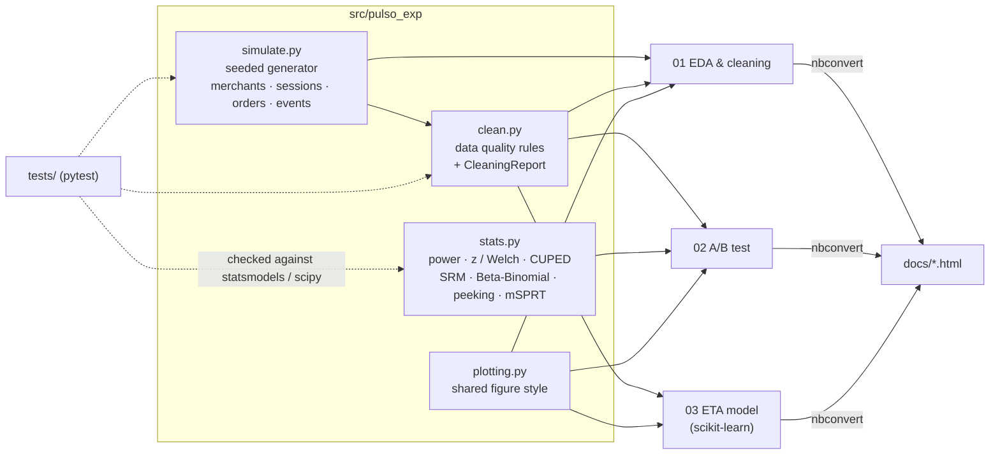

<p align="center"></p>

<p align="center"><a href="https://github.com/AlejandroAlvarez-srdev/pulso-experiments/actions/workflows/ci.yml"></a>      </p>

<h1 align="center">pulso-experiments</h1>
<!-- /header -->

Product analytics and experimentation for **Pulso**, a marketplace where merchants post delivery tasks and
independent "pulsers" carry them out. This repo is the data-science side: a seeded simulator of the checkout funnel
and delivery operations, a reusable statistics toolkit, and three executed notebooks that go from raw events to a
launch decision and a production-minded ETA model.

> **All data here is simulated.** It is generated by `src/pulso_exp/simulate.py` with a fixed seed and plants known
> effects on purpose. No number in this repo describes a real company, product or user.
>
> Pulso is a fictional company used to explore these patterns.

## At a glance

<table>
  <tr>
    <td align="center" width="25%"><b>Power, SRM, CUPED, Bayesian</b><br>A/B</td>
    <td align="center" width="25%"><b>Peeking: 4% → 26% false positives</b><br>Insight</td>
    <td align="center" width="25%"><b>ETA MAE 11.5 → 4.8 min</b><br>Model</td>
    <td align="center" width="25%"><b>46, notebooks run in CI</b><br>Tests</td>
  </tr>
</table>

## The notebooks

| notebook | question | rendered |
|---|---|---|
| [`01_eda_cleaning.ipynb`](notebooks/01_eda_cleaning.ipynb) | What is in the data, what is broken, and what do we do about it? | [HTML](docs/01_eda_cleaning.html) |
| [`02_ab_test_checkout.ipynb`](notebooks/02_ab_test_checkout.ipynb) | Should we ship the one-page checkout? | [HTML](docs/02_ab_test_checkout.html) |
| [`03_delivery_time_model.ipynb`](notebooks/03_delivery_time_model.ipynb) | Can we quote delivery times better than the legacy rule? | [HTML](docs/03_delivery_time_model.html) |

Outputs are committed, so they render on GitHub without running anything. The HTML exports in `docs/` are
self-contained and can be published with GitHub Pages.

### Key results (on the simulated data)

**01 · EDA and cleaning.** It finds the five planted data problems without looking at the generator: duplicated
sessions from ingestion retries, 15 bot merchants (hundreds of sessions, zero orders), amounts entered ×100, deliveries
stuck for hours, and missing device/latency/rating values. Each one gets an explicit rule, a row count and a reason.

**02 · A/B test: one-page checkout.**
- Pre-registered: merchant-level conversion as the primary metric, 3 % relative MDE → 16.2k merchants per arm, a
  fixed 28-day horizon.
- No sample ratio mismatch. Primary metric **51.9 % → 54.3 % (+4.5 % relative, 95 % CI +2.5 % to +6.6 %)**.
  The Bayesian read-out agrees (P(B > A) > 0.999).
- **CUPED** on pre-period GMV removes ~16 % of the variance and turns an inconclusive GMV result (p = 0.13) into a
  significant one (p = 0.02).
- **Novelty:** the lift fades from week 1 to weeks 3–4, so the lasting effect is planned at ~2–3 %, not 4.5 %.
- **Peeking:** in 2,000 simulated A/A tests, stopping at the first daily p < 0.05 gives a **26 % false-positive rate**
  instead of 5 %.
- A guardrail (cancellations) flags at the unadjusted level. The notebook works through the Holm correction, a
  merchant-level cluster bootstrap and the mechanism before deciding to monitor rather than block.
- Ground-truth check: the estimated step-level lift (+5.1 %, CI +3.6 % to +6.5 %) brackets the planted +5.8 %.

**03 · Delivery ETA model.** Gradient boosting with a time-based split cuts test MAE from **11.5 min** (legacy
`10 + 4·km` rule) to **4.8 min**. Orders arriving > 10 min after the quote drop from 45 % to 7 %. Predictions are
calibrated by decile, and quantile models give a p10–p90 band with 78 % coverage (80 % nominal). The notebook also
covers permutation importance and serving cost (a single-row predict costs about as much as a batch of 1,000).

## Sequential testing (mSPRT)

The peeking result above says "do not stop early". `stats.msprt_proportions` is the honest way to stop early: a
mixture sequential probability ratio test (Johari, Pekelis & Walsh, 2017) for a difference in proportions. With a
normal mixing prior N(0, τ²) on the difference, the likelihood ratio has a closed form, is a martingale under H0, and by
Ville's inequality crosses 1/α with probability at most α *no matter how often you look*. The always-valid p-value
is the running minimum of 1/Λ.

`stats.compare_sequential` runs the three stopping rules on the same simulated experiments. Settings mirror the
notebook's checkout test: baseline 52 %, 16,800 merchants per arm, 28 daily looks, τ = 0.02, α = 0.05, 10,000
simulations, seed 7:

| true relative lift | fixed horizon | stop at first daily p < 0.05 | mSPRT, checked daily | mSPRT avg. sample used |
|---|---|---|---|---|
| 0 % (A/A: false-positive rate) | 5.1 % | **27.7 %** | **1.5 %** | 99 % |
| 3 % (the planned MDE: power) | 81.6 % | 90.0 % | 53.0 % | 78 % |
| 4.5 % (the observed lift: power) | 99.2 % | 99.6 % | 92.5 % | 51 % |

Reading it: naive peeking buys its "power" with a 5× error rate. mSPRT keeps the error rate under α, and on a large
effect it stops at about half the planned sample, but at the pre-registered MDE it detects the effect only about half
the time. That is the real trade-off, and why the notebook keeps the fixed horizon for the launch decision. τ sets
where the test is most sensitive: τ = 0.01 and 0.05 gave 47.7 % and 46.3 % power at the MDE (same seed), so 0.02 is
close to the best choice for an expected absolute difference of about 1.6 points.

Reproduce (each call takes about 0.1 s on a MacBook Pro, Intel Core i9-9980HK):

```python
from pulso_exp.stats import compare_sequential

compare_sequential(p=0.52, lift=0.03, n_per_arm=16_800, n_looks=28, n_sims=10_000, tau=0.02, seed=7)
```

## Architecture



The simulator is the single source of data. Every notebook regenerates it in memory from the same seed (about 10 s),
so no data files are committed. `make data` writes the tables to `data/*.csv.gz` (gitignored) if you want to explore
them in another tool.

### Simulated domain

The column names are the snake_case form of the shared Pulso entities (`Order.merchantId` → `merchant_id`,
`amountCents` → `amount_cents`, currency `MXN`, statuses `DELIVERED | CANCELLED | FAILED`). The event log uses the
shared event names (`payment.authorized`, `payment.failed`, `pulser.assigned`, `assignment.failed`,
`order.cancelled`, `refund.issued`) plus checkout events.

| planted on purpose | why |
|---|---|
| +4 % lasting lift on the details → payment step, plus +8 % novelty with a 4-day half-life | checks that the analysis recovers the effect and spots the novelty |
| per-merchant activity, conversion propensity and basket size, persistent across periods | gives CUPED something real to exploit |
| bot merchants, duplicated rows, ×100 amount typos, stuck deliveries, missing values | gives the EDA real cleaning decisions |
| delivery time = prep + wait (pulser load, peaks) + travel (distance, vehicle, congestion, rain) × noise | a non-linear target with interactions for the ETA model |

## Decisions and trade-offs

- **The merchant is the randomisation and analysis unit.** Session-level tests treat correlated sessions as
  independent and overstate significance. Session-level rates appear only for description (funnel step, weekly shape),
  and the notebook says so wherever it uses them.
- **The primary metric is binary and merchant-level**, so the pre-registered z-test is valid as is. A ratio metric would
  need the delta method or a cluster bootstrap. The cluster bootstrap is shown on the cancellation guardrail.
- **CUPED uses a single pre-period covariate** to keep the method transparent. CUPAC (an ML prediction as the
  covariate) would reduce variance more, and the decision write-up lists it as a follow-up.
- **Fixed horizon for the decision, mSPRT as the sequential option.** The notebook keeps the pre-registered fixed
  horizon. `stats.msprt_proportions` adds an always-valid alternative for teams that must monitor daily (see
  [Sequential testing](#sequential-testing-msprt)); it is not used in the notebook's decision, because it costs power at
  the planned MDE.
- **`HistGradientBoostingRegressor` over XGBoost/LightGBM.** It has native categorical and missing-value support,
  needs no extra dependency, and is fast enough at 50k rows. Absolute-error loss targets the median, which matches the
  MAE metric and the skewed target.
- **Time-based split.** A random split leaks shared conditions (same rainy afternoon) between train and test and
  flatters the model.
- **Simulated data is a feature and a limit.** It makes ground-truth checks possible, but the generator has a known
  functional form, so model accuracy is optimistic compared with real data.

## How to run

Requires Python 3.12+ (the pinned versions in `requirements*.txt` were used with Python 3.14).

```bash
make install        # .venv + pinned deps + editable install of pulso_exp
make notebooks      # re-execute all notebooks in place (~3 min on a laptop)
make html           # export executed notebooks to docs/
make data           # optional: write the simulated tables to data/*.csv.gz
```

Without `make`:

```bash
python3 -m venv .venv && source .venv/bin/activate
pip install -r requirements-dev.txt && pip install -e .
jupyter lab notebooks/
```

## How to test

```bash
make lint           # ruff check + ruff format --check (also lints the notebooks)
make test           # pytest
```

The test suite (`tests/`) checks the statistics against reference implementations and the simulator and cleaning
rules against their invariants:

- sample size and Cohen's h match `statsmodels` `NormalIndPower` / `proportion_effectsize`, and the MDE inverts the
  sample size. The means version matches `TTestIndPower`.
- the z-test matches `statsmodels.proportions_ztest`. The Welch test and its CI match `scipy.stats.ttest_ind`.
- CUPED cuts variance by ρ², keeps the mean and the treatment effect, and leaves the variance unchanged when the
  covariate is useless.
- SRM passes balanced and designed-unequal splits and catches a 51/49 split.
- the Beta-Binomial posterior is the conjugate update, identical arms give P ≈ 0.5, and a clear winner gives P → 1.
  It also agrees with the one-sided p-value.
- peeking: a fixed horizon keeps α ≈ 5 %, and daily peeking more than doubles it.
- mSPRT: the closed-form likelihood ratio matches the mixture integral computed numerically with `scipy.integrate`.
  Under daily peeking in an A/A simulation it stays at or below α, while naive peeking exceeds 20 %. It loses power
  at the MDE but stops early on a large effect.
- property-based tests (Hypothesis) on arbitrary valid inputs: the z-test is antisymmetric in the arms and its CI
  brackets the estimate; SRM does not depend on arm order; mSPRT p-values stay in [0, 1], never increase between
  looks, and are symmetric in the arms (including the overflow case where the evidence is overwhelming).
- the simulator is reproducible for a given seed, keeps referential integrity, matches its events to its sessions,
  plants the effect only in the experiment period, and the novelty decays to the lasting lift.
- cleaning removes duplicates and bots (and spares heavy real merchants), reverses ×100 typos exactly and flags
  stuck deliveries.

CI (`.github/workflows/ci.yml`) runs lint and tests, then executes every notebook end to end with
`jupyter nbconvert --execute` to prove they still run.

## What this demonstrates

- **Experiment design:** pre-registration, choosing the randomisation and analysis unit, triggered analysis, power
  analysis and MDE trade-offs.
- **Inference:** two-proportion z-tests, Welch's t-test, CUPED variance reduction, SRM checks, Bayesian
  Beta-Binomial with expected loss, multiplicity (Holm), cluster bootstrap, and always-valid sequential tests
  (mSPRT).
- **Judgement:** spotting a novelty effect, sizing the lasting impact, treating a borderline guardrail honestly, and
  showing (by simulation) why peeking breaks error rates.
- **Data quality:** systematic checks and explicit, testable cleaning rules with an audit report.
- **Applied ML:** leakage-aware features, a time-based split, honest baselines, calibration, quantile intervals,
  permutation importance, and serving latency and footprint.
- **Engineering hygiene:** a reusable package with tests against reference implementations, seeded and reproducible
  data, pinned dependencies, ruff on code and notebooks, and CI that executes the notebooks.

## Repository layout

```
src/pulso_exp/   simulate.py · clean.py · stats.py · plotting.py
tests/           pytest suite for stats (incl. mSPRT and Hypothesis properties), simulator and cleaning
notebooks/       01-03, executed, outputs committed
docs/            HTML exports of the executed notebooks
```

## License

MIT, see [LICENSE](LICENSE).
